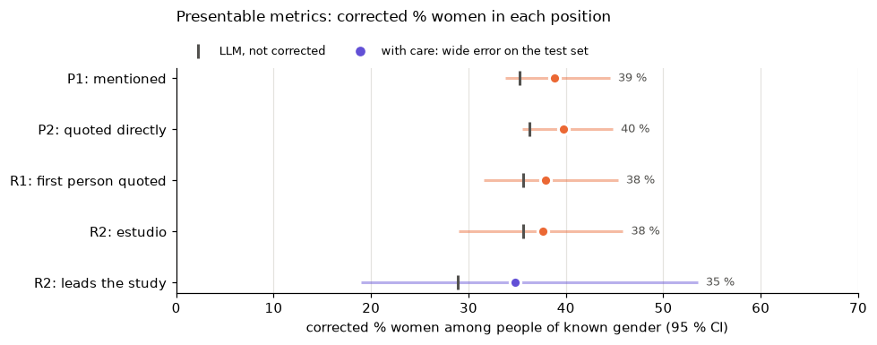
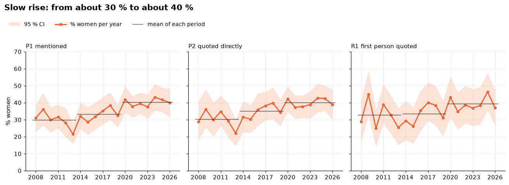
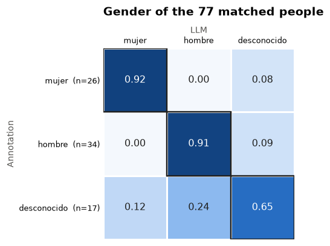

# ¿Quién es experta en salud?

**Presence and prominence of women in the health news of Agencia SINC, measured with an open LLM.**

Project for the challenge **Reto "Mujeres por la IA Abierta"**.

When a public agency reports on health, who is presented as an expert? Do women appear as the people who lead the
studies, or mostly as commentators, patients and witnesses? This repository answers the question for
[Agencia SINC](https://www.agenciasinc.es/Salud), the Spanish public science news agency (FECYT, Ministerio de
Ciencia), on 1,894 articles of its Salud section published between 2008 and 2026.

An open-weights LLM reads each article and extracts every person in it: their gender as the text presents it, their
role, their quotes and how they are introduced. The code turns those people into aggregate metrics, measures the
LLM's error on a hand-annotated test set, corrects the results for that error, and shows them in a dashboard.

## Contents

- [Main results](#main-results)
- [How it works](#how-it-works)
- [Metrics](#metrics)
- [Data and corpus](#data-and-corpus)
- [Extraction with the LLM](#extraction-with-the-llm)
- [Evaluation against a manual annotation](#evaluation-against-a-manual-annotation)
- [Installation and usage](#installation-and-usage)
- [Changing the model](#changing-the-model)
- [Repository structure](#repository-structure)
- [Ethics, privacy and licences](#ethics-privacy-and-licences)
- [Limitations](#limitations)
- [Production plan and roadmap](#production-plan-and-roadmap)
- [Third-party components](#third-party-components)
- [Team](#team)

## Main results

Women are about **four in ten** of the voices in SINC health news, and they hold the prominent positions in the same
proportion. The share has grown by about ten points since 2008, but it is still below parity, and close to the share
of women among research staff in Spain (39.6 %, *Científicas en Cifras 2025*).

Corrected estimates (LLM value minus the LLM's error on the test set) with their 95 % interval; the raw LLM value is
in parentheses. "% women" is always women / (women + men), among the people whose gender the text makes explicit.

| Metric | Result | Confidence |
|---|---|---|
| P1: % women among the people mentioned | **38.8 %** [33.8, 44.5] (LLM 35.2) | high |
| P2: % women among the people quoted | **39.7 %** [35.5, 44.8] (LLM 36.2) | high |
| P3: articles with no women / with a woman quoted | **44.9 %** [36.9, 50.9] / **47.3 %** [41.4, 55.3] | high |
| R1: % women among the first person quoted | **37.9 %** [31.6, 45.3]: same as P2, women are not put in second place | high |
| R2: % women among the people of the study | **37.6 %** [29.0, 45.8] | high |
| R2: % women among those who lead the study | **34.8 %** [19.0, 53.5] (LLM 28.9): a gap with the study members is not settled | low |
| R3: introduced with credentials, gap women − men | **+2.1 pp** [−2.6, +9.3]: no difference (women 96.7 %, men 97.5 %) | high |
| D1: topic | most women quoted in *Salud pública* (44 %), fewest in *Epidemiología* (31 %) and *Medicina interna* (28 %) | medium |
| D1: source | SINC's own pieces 35 % vs press-office pieces 38 % of women quoted, overlapping intervals: the gap is not created by the republished press releases | medium |
| D2: trend 2008-2013 → 2020-2026 | P1 +10.4 pp [+6.3, +14.6], P2 +9.8 pp, R1 +6.8 pp; articles with a woman quoted 31 % → 55 % | medium-high |

The share of articles with no women matches what chance gives in every period (within ±2 pp): articles have few
voices each (about two people of known gender), and women are not concentrated in a few articles.

D1 and D2 are LLM values: the test set is too small to measure the error for each topic, source or period, so only
their differences are read, not their levels.

**Not reported as findings:** P3 "women mentioned but not quoted" (2 test cases), the roles `experta_externa`,
`paciente_testimonio` and `otro` (too few test cases, or the LLM confuses them), and single years (±6-8 pp).





All the tables are in [data/metrics/](data/metrics/), the figures in [reports/figures/](reports/figures/), and the
interactive version in the [dashboard](#3-dashboard).

## How it works

```
src/scrape.py            index → bounds → sample → fetch → select
                         SINC Salud listing → stratified corpus, 150 articles per year (CC licence only)
                           → data/corpus.csv, data/articles.jsonl
src/annotation_sample.py 50 corpus articles for the manual annotation (10 development, 40 test)
                           → data/annotations/sample.csv, ground_truth.xlsx (filled in by hand)
src/extract.py           one LLM call per article, JSON validated with pydantic, cached on disk
                           → data/mentions.jsonl (one row per person per article)
src/evaluate.py          LLM vs manual annotation on the 40 test articles
                           → data/metrics/evaluation_*.csv, llm_*error_bootstrap.csv, figures
src/metrics.py           metrics on the corpus, corrected with the error measured above
                           → data/metrics/results_*.csv, figures
src/dashboard.py         Streamlit dashboard, reads only the aggregate tables in data/metrics/
```

## Metrics

Seven metrics, chosen to answer the question with as few measures as possible, each one checked against the manual
annotation. P1 to R3 rest on the people extracted by the LLM; D1 and D2 break them down by SINC's own metadata.

**Presence: who appears and who speaks**

- **P1.** % women among the people **mentioned**, named or not, quoted or not.
- **P2.** % women among the people **quoted directly** (in quotation marks, or interviewed).
- **P3.** **Women in the article**, one category per article with at least one person of known gender: *no women*,
  *women mentioned but not quoted* (present without a voice), *women quoted*. The three shares add up to 100 %.
  "No women" is compared with what chance gives, with the share of P1 and the real number of people in each article.

**Prominence: in which position**

- **R1.** % women among the **first person quoted** in each article (interviews excluded, since the interviewee
  always speaks first). Read against P2: if women were put in second place, R1 would be below P2.
- **R2.** **Role** of each person: `estudio` (part of the study the article is about, and whether the text
  explicitly says they *lead* it: "lidera", "dirige", "coordina"), `experta_externa` (an outside expert asked to
  comment), `paciente_testimonio` (patient or witness), `otro` (institutions, politicians, organisers…).
- **R3.** **Credentials:** share of named women and named men introduced with their position, profession or
  institution rather than the name alone, and the gap women − men.

**Distribution: where and when**

- **D1.** P1, P2 and R1 by **topic** (SINC's own 12 subsections, assigned by the newsroom, no LLM classification) and
  by **source** (SINC's own pieces vs pieces from an institution's press office, from SINC's `fuente` field). It
  answers whether the gap is created in the newsroom or in the press releases SINC republishes.
- **D2.** **Trend** of P1, P2 and R1 over 2008-2026, read by period (2008-2013, 2014-2019, 2020-2026), because a
  single year has an interval of ±6-8 pp.

**Uncertainty and correction.** Every metric is reported in three steps: the LLM's value on the corpus with a
bootstrap interval over articles (2,000 replicates; people in the same article are not independent); the LLM's error
on the 40 test articles, with a paired bootstrap; and the **corrected estimate** (value − error), whose interval
combines the sampling of the corpus and of the test set. Each metric is then judged by fixed rules
([src/metrics.py](src/metrics.py)): *not presentable* when the test set has fewer than 10 annotated cases for it or
the LLM recognises too few of the annotated people of the group; *with care* when the error's interval is wider than
±10 pp; *presentable* otherwise.

**Explored and dropped**, because they were unreliable, redundant or showed nothing: share of quoted words by women
(quote detection misses quotes spanning several paragraphs), people mentioned without a name (1.4 % of the people),
mentions in the title or lead (3 test cases), honorifics such as Dr. or Prof., quotes per person, and whether a quote
was given directly to SINC (79 % agreement with the annotation; the source in D1 answers the same question with
SINC's metadata).

## Data and corpus

| Step | Result |
|---|---|
| Index of the Salud listing (Noticias, Reportajes, Entrevistas) | 9,571 articles, June 2007 - October 2026 ([data/index.csv](data/index.csv)) |
| Stratified random sample, seed 42 | 170 per year 2008-2026 (150 + 20 buffer): 3,230 articles ([data/sample.csv](data/sample.csv)) |
| Download and parsing | 3,220 parsed; 10 excluded because SINC files them under another section |
| Selection | **150 per year, 2,850 articles** ([data/corpus.csv](data/corpus.csv)); 66 excluded because they are not CC-licensed |
| Analysed | extraction rounds 1 and 2: **1,894 articles, 100 per year** (the 10 development articles excluded) |

Not in the corpus: 2007 (only ~12 articles), opinion pieces (external authors writing in the first person) and
*En exclusiva* (disallowed by robots.txt).

The article body excludes pull quotes (they repeat sentences of the text), photo captions, related-article boxes, the
bibliographic reference and share buttons. In interviews, the journalist's questions are marked `[PREGUNTA]`.
Average length: 661 words.

## Extraction with the LLM

[src/extract.py](src/extract.py), with the prompt in [src/prompts.py](src/prompts.py) and the output schema in
[src/schema.py](src/schema.py). The prompt follows the annotation guidelines
([data/annotations/GUIDELINES.md](data/annotations/GUIDELINES.md)) rule by rule, so the LLM and the annotators
apply the same definitions.

- **Gender from the text, not from the name.** Spanish grammatical gender ("la investigadora", "el jefe de
  servicio") lets the model take the gender from a word in the text, which it must copy as `gender_evidence`. The
  code checks that the evidence is in the article, close to the person (150 characters), is not a masculine plural
  (Spanish uses it for mixed groups) and is not just the person's name; otherwise gender becomes `desconocido`.
- **Quotes cannot be invented.** Before the call, the code numbers every text in quotation marks (`«…»[C1]`,
  `“…”[C2]`; SINC mixes «», “” and straight quotes). The model only assigns quote ids to people, to collective
  sources or to "not a quote" (terms, titles), so every attributed quote is verbatim.
- **Post-processing in code:** merges duplicate people ("Úbeda" and "Carles Úbeda"), normalises the values that
  follow from other fields, and computes which person is quoted first and how many words each one says.
- **Cache and versioning:** raw responses are stored in `data/cache/<model>/<prompt hash>-<settings hash>/<id>.json`.
  Changing the prompt or the call settings invalidates them; repeating a run does not call the model again. Each row
  of `mentions.jsonl` records `model` and `run`.
- **Settings** ([config.yaml](config.yaml)): temperature 0, `max_tokens` 6000, output forced to the JSON schema,
  reasoning off.
- **Models tried** on the 10 development articles: `gemma4:26b`, `gpt-oss:20b`, `qwen3.8:27b`. The corpus was run
  with `qwen3.8:27b` (run `816ee2d9-5ff903-p2`) on a self-hosted Ollama server.
- **Cost of the full run:** 1,896 calls, 0 errors, 7.36 M input tokens, 0.94 M output tokens, about 11 s per
  article (about 5.6 h of model time).

## Evaluation against a manual annotation

The success criterion is **the error of each aggregate metric with respect to the manual annotation**, not the
accuracy on each person. 50 corpus articles were annotated by hand
([data/annotations/sample.csv](data/annotations/sample.csv), guidelines in
[GUIDELINES.md](data/annotations/GUIDELINES.md)):

| Set | Articles | Use |
|---|---|---|
| Development | 10 (2 annotated by all three of us, for calibration) | tuning the prompt |
| Test | 40 | final evaluation only, never seen while developing the prompt |

The 40 test articles contain 79 annotated people (28 women). Results of [src/evaluate.py](src/evaluate.py):

| What | Result |
|---|---|
| People found | precision 94 %, recall 97 %, **F1 96 %** |
| Gender | 86 % agreement (92 % where the annotation gives a gender); **no `mujer` ↔ `hombre` swaps**, every error is to or from `desconocido` |
| Role | 88 %; `estudio` 56 of 56; only 5 of 12 external experts recognised |
| Other fields | quoted 99 %, first quoted 100 %, introduced with credentials 96 %, leads the study 93 % |
| Quote attribution | 77 % of the quotes (82 % of the words) have the same owner on both sides |
| Error on P1 / P2 / R1 | −3.6 pp [−8.9, +1.0] / −3.5 pp [−8.0, +0.3] / −2.3 pp [−9.3, +3.5] |
| Error on R2 study / leads the study | −2.0 pp [−10.1, +6.4] / −5.9 pp [−24.3, +10.0] |
| Error on P3 no women / women quoted | +4.7 pp / −4.5 pp |

**Main weakness:** the LLM underestimates % women by 2-4 pp in every metric, because it leaves about 9 % of the
quoted people as `desconocido` (against 2 % in the annotation): it cites the name as evidence instead of the gendered
word, and the check rejects it. The corpus results are corrected for this error.



## Installation and usage

Requires Python 3.12.

```bash
git clone <this repository> && cd mujeres-ia
python -m venv .venv && source .venv/bin/activate
pip install -r requirements.txt
```

Every command runs from the repository root. All settings are in [config.yaml](config.yaml); missing keys stop the
scripts with a clear error.

### What can be reproduced from this repository

The repository publishes the article URLs, the annotation sample and the aggregate metrics, but **not** the full
texts, the extracted people or the manual annotations (see [Ethics](#ethics-privacy-and-licences)). So:

- the **dashboard** runs directly on the published tables;
- the **corpus** and the **extraction** can be rebuilt from the published URLs and any OpenAI-compatible endpoint;
- the **evaluation** needs `data/annotations/ground_truth.xlsx`, which is not published. Its outputs are: the
  error replicates in `data/metrics/llm_*error_bootstrap.csv` let `metrics.py` correct a rebuilt run of the same
  model and prompt; a new model or prompt needs a new annotation to be evaluated.

### 1. Corpus

```bash
python -m src.scrape index     # walks the Salud listing         → data/index.csv
python -m src.scrape bounds    # where each year starts           → data/year_bounds.json
python -m src.scrape sample    # 170 random articles per year     → data/sample.csv
python -m src.scrape fetch     # downloads and parses them         → data/articles.jsonl, data/raw/
python -m src.scrape select    # 150 per year, CC licence only    → data/corpus.csv
```

The scraper respects robots.txt, waits 1 second between requests, retries on network errors and can be resumed. To
rebuild the same corpus, skip `index`, `bounds` and `sample` and start from `fetch`, which reads the published
`data/sample.csv`.

`python -m src.annotation_sample` rebuilds the annotation sample and an empty annotation sheet. It refuses to change
the existing split and never overwrites an existing `ground_truth.xlsx`.

### 2. Extraction, evaluation and metrics

```bash
export LLM_API_KEY=...                       # the variable named in llm.api_key_env
python -m src.extract --split dev            # the 10 development articles
python -m src.extract --round 1              # 50 articles per year (round 2: --round 2)
python -m src.extract --round 1 --year 2008  # one year of a round
python -m src.evaluate                       # LLM vs annotation on the 40 test articles
python -m src.metrics                        # metrics on the corpus, corrected
```

Rounds take articles in a fixed random order (seed 42), so any finished round is balanced by year. `evaluate.py`
and `metrics.py` analyse the run named in `analysis` in config.yaml.

### 3. Dashboard

```bash
python -m streamlit run src/dashboard.py
```

It reads only the aggregate tables in `data/metrics/`, so it can be deployed publicly without any data about
individual people. It shows the corrected metrics, the trend, the breakdown by topic and source, and a limitations
section with the errors measured on the test set.

## Changing the model

The code is model-agnostic: it uses the OpenAI client against any compatible endpoint (Ollama, vLLM, OVH AI
Endpoints…). Edit `llm` in [config.yaml](config.yaml):

```yaml
llm:
  base_url: https://oai.endpoints.kepler.ai.cloud.ovh.net/v1   # e.g. OVH AI Endpoints
  model: gpt-oss-120b
  api_key_env: LLM_API_KEY      # name of the variable with the key; the key never goes in the file
  ca_cert:                      # empty unless the endpoint uses a private certificate authority
  reasoning_effort:             # null = model default; "none" turns reasoning off on Ollama
```

The `base_url` and `ca_cert` in the committed config point to the self-hosted server used for the project; replace
them. A new model or prompt writes to a new cache folder and a new `run`: set `analysis.model` and `analysis.run`
to analyse it, and run `src.evaluate` again before trusting its metrics.

## Repository structure

```
mujeres-ia/
├── config.yaml             # LLM endpoint and settings, scraping, sample, analysed run, paths
├── requirements.txt        # pinned versions
├── LICENSE                 # Apache-2.0
├── .streamlit/config.toml  # dashboard theme
├── src/
│   ├── config.py           # loads and checks config.yaml
│   ├── scrape.py           # SINC listing → corpus
│   ├── annotation_sample.py
│   ├── prompts.py          # extraction prompt (Spanish), same rules as GUIDELINES.md
│   ├── schema.py           # pydantic models of the LLM output
│   ├── extract.py          # LLM extraction, quote numbering, checks, cache
│   ├── evaluate.py         # LLM vs manual annotation
│   ├── metrics.py          # metrics, bootstrap intervals, correction, presentability
│   ├── plots.py            # figures of evaluate.py and metrics.py
│   └── dashboard.py        # Streamlit
├── data/
│   ├── index.csv, sample.csv, corpus.csv, year_bounds.json   # URLs and metadata only
│   ├── annotations/
│   │   ├── GUIDELINES.md   # annotation guidelines (Spanish)
│   │   └── sample.csv      # annotated articles and their split
│   └── metrics/            # aggregate results, evaluation tables, error replicates
└── reports/figures/        # figures of the evaluation and of the results
```

Generated locally and not published (in `.gitignore`): `data/articles.jsonl` and `data/raw/` (full texts),
`data/mentions.jsonl` (extracted people), `data/cache/` (model responses), `data/annotations/*.xlsx` (annotations).

## Ethics, privacy and licences

- **Data licence.** Most SINC content is licensed CC BY 4.0. Each article's rights field is checked and non-CC
  articles are excluded (66 in the sample). The licence requires citing SINC and the author, and does not allow
  publications made mostly of SINC content: this repository contains code, URLs and aggregate metrics, **not** the
  full texts. robots.txt is respected, with 1 request per second.
- **Personal data.** The names of the people quoted are personal data, even when they appear in a public
  professional role. Only aggregates are published, with no per-person gender labels; the extracted people and the
  annotations stay private. Legal basis: public interest and scientific research (GDPR art. 6.1.e and art. 89).
- **Gender.** We measure the **grammatical gender the text attributes** to a person, not their gender identity. It is
  binary because of a limitation of the language, with an explicit `desconocido` when the text gives no clue
  (including masculine plurals, which Spanish uses for mixed groups). The gender is never inferred from the name.
- **Journalists are not analysed:** most bylines are "SINC" or an institution, and inferring gender from names would
  break the project's own rule.
- **AI Act.** An aggregate analysis system that makes no decisions about people: minimal risk.

## Limitations

- The correction assumes that the error measured on the 40 test articles holds for the whole corpus.
- The test set is small: one annotator per article, and annotator agreement was not measured (the two calibration
  articles were discussed together), so the reliability of the reference itself is unknown. Rare categories
  (`paciente_testimonio`, 2 cases) and errors per year, topic or period cannot be measured.
- Quote detection misses quotes that span several paragraphs or use irregular marks (412 words on the test set, 75 %
  of them by women). This is why the share of quoted words was dropped.
- The model confuses `experta_externa` with `otro` and `estudio`, so the role of outside experts is not reported.
- Only the Salud section of one agency; the results describe SINC, not Spanish health journalism as a whole.
- No comparison with a simple baseline (named-entity recognition plus grammatical-gender rules).

## Production plan and roadmap

- **Production:** a scheduled monthly run (scraping of the new articles, extraction, metrics) on a cloud instance, an
  open model on a managed endpoint (for example `gpt-oss-120b` on OVH AI Endpoints) and the public dashboard.
- **Agreement with SINC/FECYT** so that the newsroom can use the tool as an internal indicator of source parity.
- **Extension** to other media with open licences, or through agreements with them.
- **Next steps:** annotate more articles, part of them twice to measure agreement, and with more study leaders and
  outside experts; fix the detection of quotes spanning several paragraphs; evaluate further prompt changes on new
  articles, not on the current 40.

## Third-party components

| Component | Use | Licence |
|---|---|---|
| [requests](https://github.com/psf/requests) | HTTP client of the scraper | Apache-2.0 |
| [Beautiful Soup 4](https://www.crummy.com/software/BeautifulSoup/) | HTML parsing | MIT |
| [openai](https://github.com/openai/openai-python) | client for any OpenAI-compatible endpoint | Apache-2.0 |
| [pydantic](https://github.com/pydantic/pydantic) | validation of the LLM output | MIT |
| [pandas](https://pandas.pydata.org/), [NumPy](https://numpy.org/) | metrics and bootstrap | BSD-3-Clause |
| [Streamlit](https://streamlit.io/) | dashboard | Apache-2.0 |
| [Vega-Altair](https://altair-viz.github.io/) | dashboard charts | BSD-3-Clause |
| [Matplotlib](https://matplotlib.org/) | figures | Matplotlib licence (PSF-based) |
| [PyYAML](https://pyyaml.org/) | configuration | MIT |
| [openpyxl](https://openpyxl.readthedocs.io/) | annotation sheets | MIT |
| [Ollama](https://ollama.com/) | self-hosted model server | MIT |
| `qwen3.8:27b` | extraction model (open weights) | see the model card |
| `gpt-oss-120b` | proposed production model | Apache-2.0 |
| [Agencia SINC](https://www.agenciasinc.es/) | source articles | CC BY 4.0 (CC-licensed articles only) |

## Team

Gaia Volpi, Giulia Garagozzo and Tamara Al-Abbadi.

## Licence

Code under the [Apache License 2.0](LICENSE). The articles analysed belong to Agencia SINC and their authors, and are
used under CC BY 4.0.
